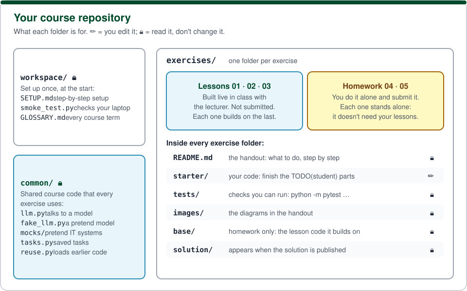

# Agentic AI — course workspace

This is your personal copy of the practical part of the Agentic AI course. You'll build an **IT-support agent** in plain Python, in two kinds of exercises:

- **Lessons 01–03**, built live in class with the lecturer. You follow along in your own copy. They aren't submitted, and each one builds on the previous lesson.
- **Homework 04–05**, which you do on your own and submit. Each homework **stands alone**: it brings its own copy of the lesson code, so it works whatever state your lesson folders are in.

| # | Exercise | Folder |
|---|---|---|
| 01 | My first agent (lesson, in class) | [`exercises/01-first-agent/`](exercises/01-first-agent/README.md) |

New exercises appear here as they're released. The course's finished version of each one is published later in its `solution/` folder: the day after a lesson, and 2–3 weeks after a homework is released. `workspace/SETUP.md` step 12 shows how to get both.

## Start here

1. Follow **[`workspace/SETUP.md`](workspace/SETUP.md)** once. It covers accounts, installs, the AI model, creating your private repository, and how to submit homework.
   Prefer to watch? The [course videos](https://github.com/alexsherba29/agentic-ai-course-student/releases/tag/course-videos) show the setup and Git basics step by step.
2. Check your setup: `python workspace/smoke_test.py`
3. Keep the **[glossary](workspace/GLOSSARY.md)** open: every course word (agent, tool, mock, `common/`, …) explained in plain language.
4. Open the first exercise's `README.md`.

## How this repository is organised

- `workspace/`: the setup guide, the smoke test (it checks that your laptop is ready) and the glossary.
- `common/`: **shared course code** that every exercise uses, so you don't write it again each time. Read it, but **don't change it**: the tests and the grading use the course's own copy. Inside:
  - `llm.py`: the single way your agent talks to a model, real (Ollama) or pretend (FakeLLM);
  - `fake_llm.py`: **FakeLLM**, a pretend model that follows a fixed script, so the tests give the same result on every laptop, even without Ollama;
  - `mocks/`: **mocks**, pretend versions of a company's IT systems (a service status page, a ticket system, a library of support guides). They run in memory on your laptop, send nothing anywhere, and can fail on purpose so you can test what your agent does;
  - `tasks.py`, `reuse.py`, `eval.py`: saved tasks, loading earlier lesson code, and comparing two agents.
- `exercises/NN-name/`: one folder per exercise.
  - `README.md`: the handout, with what to do step by step.
  - `starter/`: **your code**. This is the folder you edit, plus `answers.md` in the homework.
  - `tests/`: the public tests (`python -m pytest exercises/NN-name/tests`). Don't edit them: grading uses its own copy.
  - `images/`: the diagrams in the handout.
  - `reference/` (lessons) and `base/` (homework): the course's copy of earlier lesson code, used underneath your code.
  - `solution/`: appears once the solution is published.

## Course staff

- **Dr. Eran Beeri-Bamani**, course lecturer. Founder and director of the Physical Human Intelligence Lab (PHI Lab).
- **Alex Scherbakov**, course TA.

**Questions?** Email **eran.beeri-bamani@biu.ac.il**.

## Submitting homework

Only the homework (04 and 05) is submitted, each as a link to its folder at a tag, for example:
`https://github.com/<you>/<repo>/tree/ex04-submit/exercises/04-failures`
The full steps are in `workspace/SETUP.md`, step 11.
