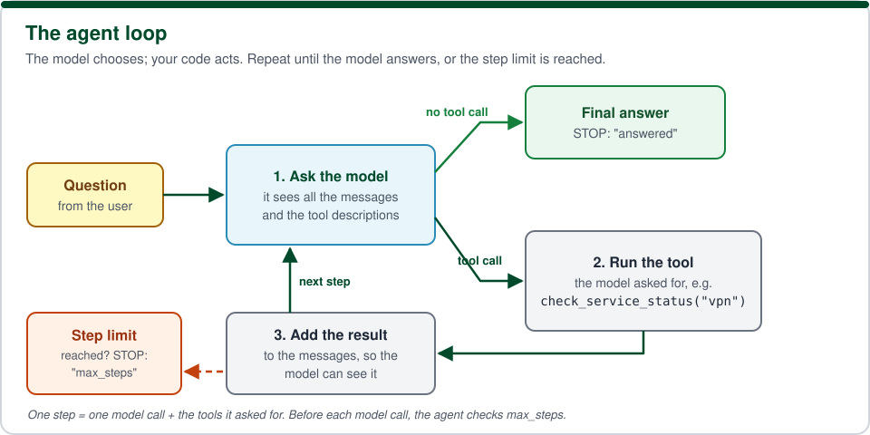
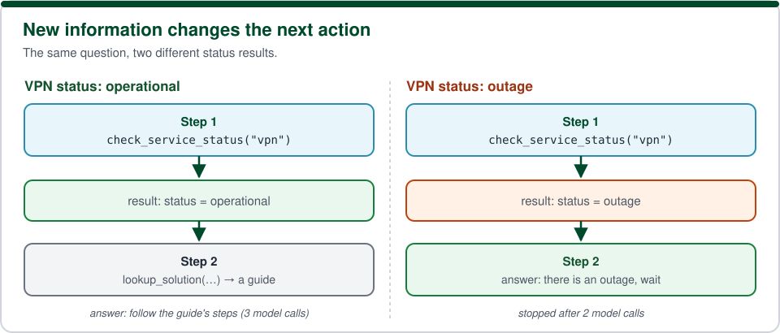

# Lesson 01 — My first agent

**In class.** The lecturer builds this lesson live, step by step, and you follow along in your own copy. Nothing is submitted or graded. If you fall behind, keep watching: the finished code is published the day after the lesson (section 8).

We'll finish a small IT-support agent. It can check whether a service (like the VPN) is working and look up a support guide. We'll write the **loop** that makes it an agent: the model chooses a tool, the agent runs it, the model sees the result, and the agent either continues or stops, never taking more than a fixed number of steps.

## 1. Learning goals

- **Explain** what makes a program an *agent*: a loop in which a model chooses actions and sees their results.
- **Implement** the loop: run the tool the model chose, give it the result, and stop when it answers.
- **Enforce** a hard step limit, so an agent can never run forever.
- **Show** how new information (a tool result) changes the agent's next action.

## 2. Before the lesson (downloads)

Nothing new: the workspace from `workspace/SETUP.md` is enough. Before class, check that it works.

- Required: your course repository, with `.venv` activated, where `python workspace/smoke_test.py --fake-only` prints READY.
- **Optional:** Ollama with `llama3.2:3b` (SETUP.md step 8), only for the "try a real model" run. Everything else works without it.

## 3. Concepts

**Key terms** (each one is explained in plain words in the [glossary](../../workspace/GLOSSARY.md)): agent, model, tool, tool call, messages, system prompt, step, `max_steps`, FakeLLM, mock, test.

**A tool** is an ordinary Python function the agent may use, such as `check_service_status("vpn")`. The model can't run code. It can only *ask* for a tool, by name and with arguments. Our code runs the tool and shows the model the result.

**The conversation** (`messages`) is the agent's memory: a list of messages with the system instructions, the user's question, the model's replies and the tool results. Every model call sees the whole list. That's why adding a tool result to `messages` lets new information change the next action.

**An agent** is a loop around the model:



**A step** is one model call plus the tools it asked for. `max_steps` caps the number of model calls. Real models sometimes go round in circles, for example by checking the same thing again and again, and every call costs time and money.

**Where the pieces come from.** The model is reached through `common/llm.py`, the course's single way of talking to a model. In class we use **FakeLLM**, a pretend model that follows a short script, so everyone gets the same result. The tools use **mocks**: pretend IT systems (a status page and a set of support guides) that run in memory on your laptop. Both live in `common/`, the shared course code; you read it but never change it.

The code is in [`starter/agent.py`](starter/agent.py). The tools are in [`starter/tools.py`](starter/tools.py) and are already finished: read their descriptions in `TOOL_SPECS`, because that's what the model reads. `Step` and `AgentResult` are *dataclasses*: small classes that just hold values. You create one like a function call with keyword arguments, for example `Step(step=1, tool="lookup_solution", arguments={...}, result={...})`.

## 4. What we're starting from

This is the first lesson, so we start from the provided code. Lessons 02 and 03 build on **your own** copy of this one, so keep it.

| File | Status |
|---|---|
| `starter/tools.py` | ✅ done: `check_service_status` and `lookup_solution`, connected to the mocks |
| `starter/demo.py` | ✅ done: runs the agent and prints every step. Its fake model (`demo_policy`) is a few if-statements that act like a sensible model |
| `starter/agent.py` | ✏️ **we complete four `TODO(student)` blocks** |
| `common/` | ✅ shared course code (model interface, fake model, mocks). Read it, but don't edit it |

Right now `python exercises/01-first-agent/starter/demo.py` runs one step, then stops with `NotImplementedError: TODO(student) 3 …`, and all the tests fail. That's expected: it's where we start.

## 5. What we build in class

We go in order; each step builds on the previous one. After each step, we run its check together.

1. **Stop when the model answers.** File `starter/agent.py`, function `run_agent`, block `TODO(student) 1`.
   If the model's reply has no tool calls, it's the final answer: return an `AgentResult` with the model's text and `stopped_reason="answered"`.
   Check: `python -m pytest exercises/01-first-agent/tests -k final_answer` → **1 passed**.

2. **Run the tool the model chose.** File `starter/agent.py`, function `run_tool`, block `TODO(student) 2`.
   Look the tool up by its name and call it with the model's arguments. A tool that raises an exception must **not** crash the agent: return a dict with an `"error"` key that says what went wrong, so the model can read it and try something else. (Unknown tool names are already handled, and show the pattern.)
   Check: `python -m pytest exercises/01-first-agent/tests -k run_tool` → **1 passed**.

3. **Use the result and continue.** File `starter/agent.py`, function `run_agent`, block `TODO(student) 3`.
   For each tool call: run it with `run_tool`, add the result to `messages` with `tool_message(...)`, record a `Step`, and print it with `log_tool_result(...)`. Then remove the `raise` line, so the loop goes round and asks the model again.
   Check: `python exercises/01-first-agent/starter/demo.py` now runs to a final answer, and `python -m pytest exercises/01-first-agent/tests -k fed_back` → **1 passed**.

4. **Never take more than `max_steps` steps.** File `starter/agent.py`, function `run_agent`, block `TODO(student) 4`.
   Before each model call, stop if `model_calls` has reached `max_steps`: return `FALLBACK_ANSWER` with `stopped_reason="max_steps"`.
   Check: `python exercises/01-first-agent/starter/demo.py --max-steps 1` stops after one model call, and `python -m pytest exercises/01-first-agent/tests` → **5 passed**.

5. **See new information change the next action.** We run the demo twice and compare **step 2**:
   ```
   python exercises/01-first-agent/starter/demo.py --vpn-status operational
   python exercises/01-first-agent/starter/demo.py --vpn-status outage
   ```
   

## 6. How to run and test

Run everything from the **top folder of your repository**, with `.venv` active. The commands are the same on Windows, macOS and Linux.

```
# the demo, with the fake model (no Ollama needed)
python exercises/01-first-agent/starter/demo.py
python exercises/01-first-agent/starter/demo.py --vpn-status outage
python exercises/01-first-agent/starter/demo.py --max-steps 1
python exercises/01-first-agent/starter/demo.py --question "My email is not arriving"

# the tests: all of them, or just one step's (-k picks tests whose name contains the word)
python -m pytest exercises/01-first-agent/tests
python -m pytest exercises/01-first-agent/tests -k run_tool
```

**Optional: try a real model** (needs Ollama running, SETUP.md step 8):

```
python exercises/01-first-agent/starter/demo.py --backend ollama
python exercises/01-first-agent/starter/demo.py --backend ollama --vpn-status outage
```

A real model doesn't always follow its instructions. Watch whether it checks the status first, and whether it stops. That's exactly why `max_steps` exists.

## 7. What success looks like

`python -m pytest exercises/01-first-agent/tests` shows **5 passed**. With the VPN working, the demo prints something like:

```
[step 1] model chose tool → check_service_status({'service': 'vpn'})
           tool result → {'service': 'vpn', 'status': 'operational', 'message': 'VPN is working normally.'}
[step 2] model chose tool → lookup_solution({'problem': "I can't connect to the VPN from home. What should I do?"})
           tool result → {'found': True, 'guide': 'VPN connection troubleshooting', 'text': ...
[step 3] model answered → The service is working, so the problem is probably on your side. Please follow the steps in the guide 'VPN connection troubleshooting'.

Final answer : The service is working, so the problem is probably on your side. Please follow the steps in the guide 'VPN connection troubleshooting'.
Stopped      : answered after 3 model call(s)
```

With `--vpn-status outage`, step 2 is an answer instead of a guide lookup, and the run stops after **2** model calls. With `--max-steps 1`, step 1 runs, then the step-limit message appears (for example `Stopped: reached max_steps=1 without a final answer.`), and the run ends with `max_steps after 1 model call(s)`.

## 8. After the lesson

**Get the finished code.** The day after the lesson, the course's version is published in `solution/`. Add it to your repository without touching your own `starter/` (the very first time, run the `git remote add course …` line from SETUP.md step 12 first):

```
git fetch course
git checkout course/main -- exercises/01-first-agent/solution
```

Then compare: `python exercises/01-first-agent/solution/demo.py`. If your `starter/agent.py` isn't finished, you can copy the solution's `agent.py` over it; lesson 02 builds on it.

**Think about it** (we discuss these in class):

1. In the two runs of step 5, what did the agent do at step 2 in each case, and **what information caused the difference**?
2. Run the demo with `--max-steps 1`. What happened? Describe a situation where an agent **without** `max_steps` would cause a problem.

**Try it yourself** (optional):

- Ask about something that isn't one of the services (`--question "Is the teleporter down?"`). The fake model asks you back instead of guessing. Why is that better? What does a real model do with the same question?
- Add a third tool to `starter/tools.py`, for example `list_services()`, with its `tool_spec` in `TOOL_SPECS`. Does the real model ever use it?
- Run the same question 3 times with `--backend ollama`. Are the steps always the same? Why might they differ?
